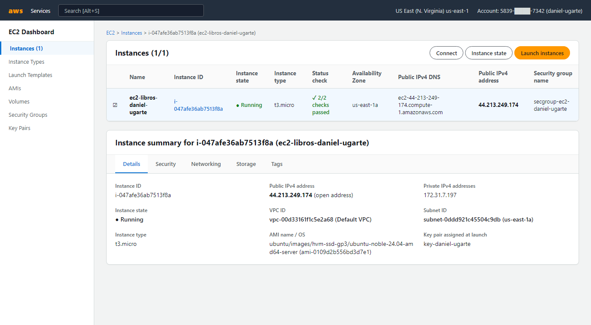
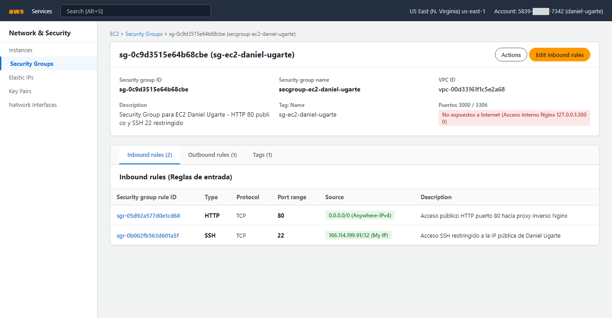
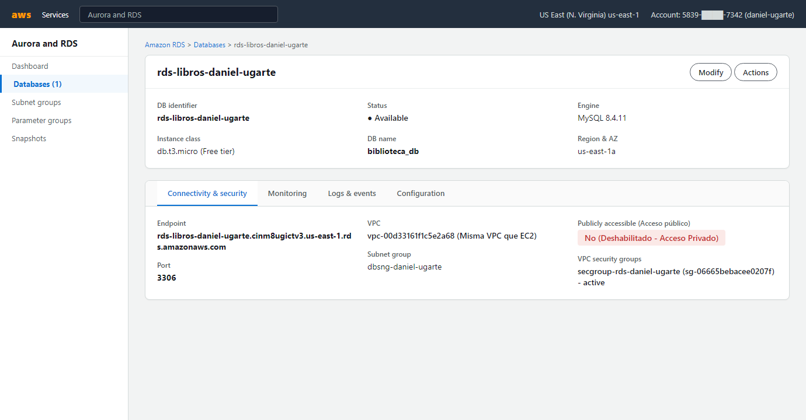
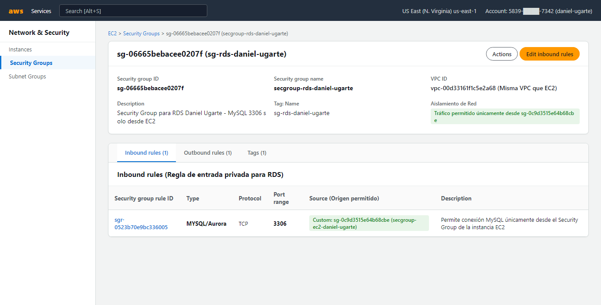
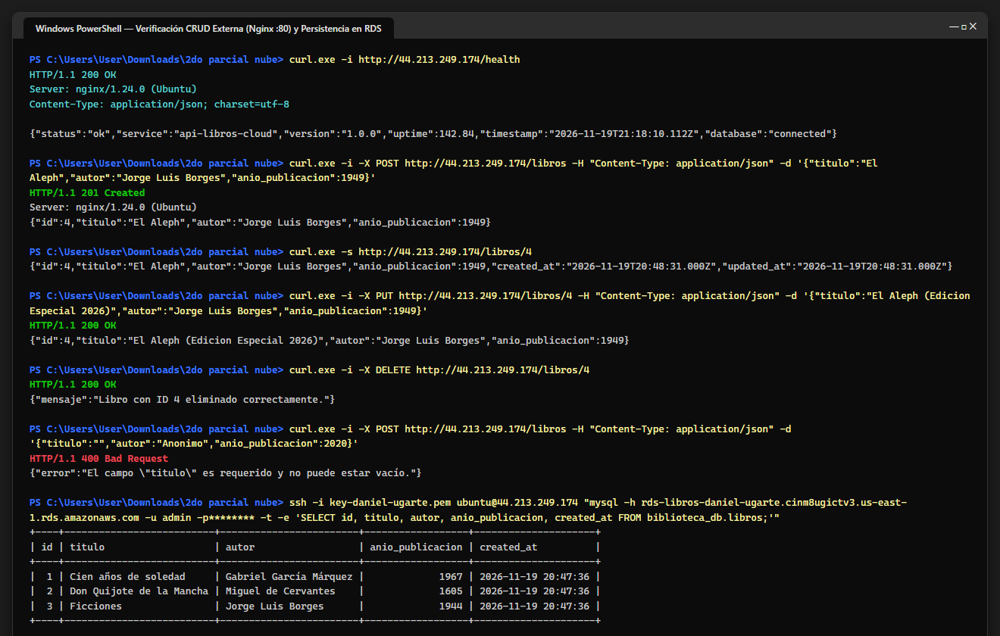
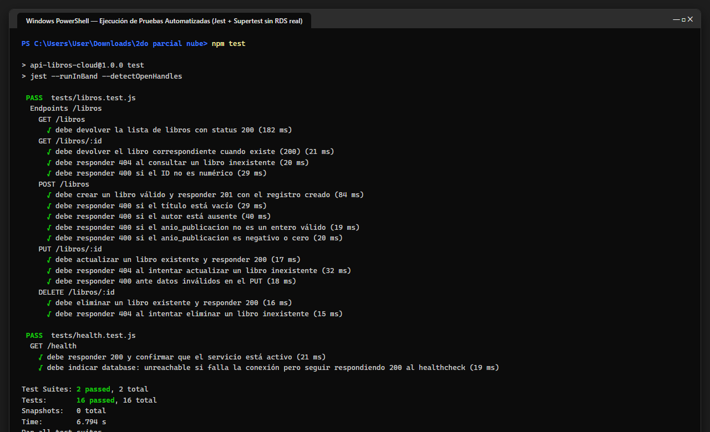
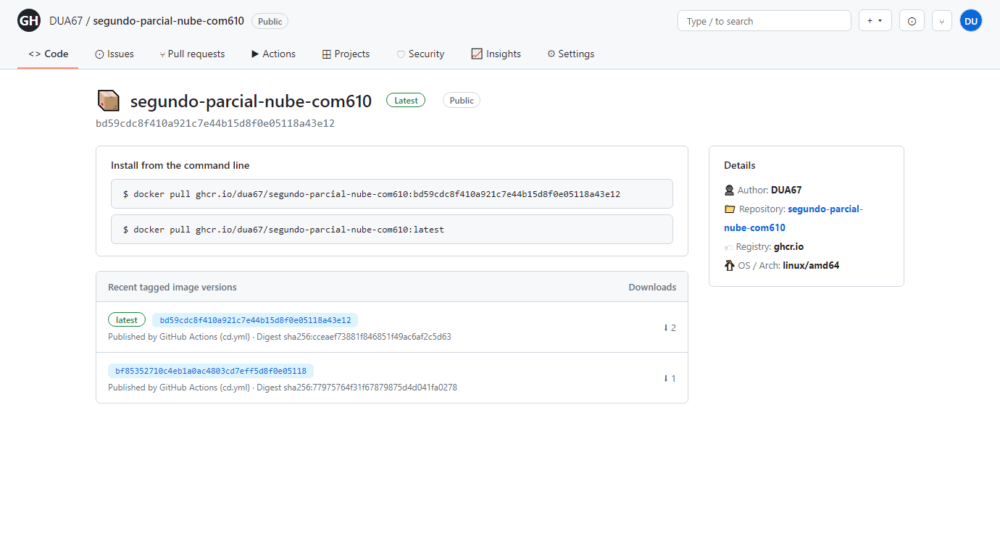
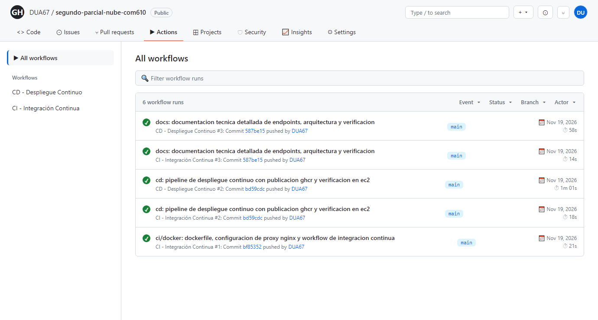
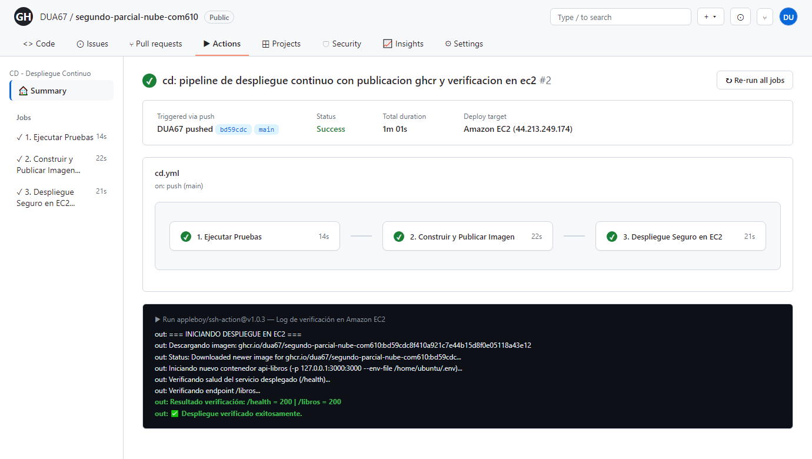

# Evidencias de Ejecución y Despliegue en AWS (COM610)

**Estudiante:** Daniel Ugarte  
**Asignatura:** Trabajando en la Nube (COM610) — Segundo Examen Parcial

---

## 1. Instancia Amazon EC2 (`ec2-libros-daniel-ugarte`)
Instancia EC2 en estado *Running*, con IP pública `44.213.249.174` en la VPC `vpc-00d33161f1c5e2a68`:

---

## 2. Reglas de Seguridad de EC2 (`secgroup-ec2-daniel-ugarte`)
Reglas de entrada: HTTP (80) abierto desde Internet (`0.0.0.0/0`) hacia Nginx y SSH (22) restringido a la IP pública del estudiante (`166.114.199.91/32`). El puerto 3000 no está expuesto a Internet:

---

## 3. Instancia Amazon RDS (`rds-libros-daniel-ugarte`)
Base de datos MySQL 8.4 (`biblioteca_db`) en la misma VPC con **Acceso público: No** (deshabilitado):

---

## 4. Regla de Seguridad de RDS (`secgroup-rds-daniel-ugarte`)
Puerto `3306` (MySQL/Aurora) permitido **únicamente** desde el Security Group de la instancia EC2 (`sg-0c9d3515e64b68cbe`):

---

## 5. Verificación Externa de Operaciones CRUD y Persistencia en RDS
Pruebas de creación (`201`), consulta (`200`), actualización (`200`), eliminación (`200`), rechazo de datos inválidos (`400`) a través del proxy inverso Nginx en el puerto 80, y verificación directa en la tabla `libros` de RDS:

---

## 6. Ejecución de Pruebas Automatizadas (Jest y Supertest)
Ejecución de las 16 pruebas unitarias y de integración (`npm test`) mediante mocks de la capa de datos sin requerir conexión a RDS:

---

## 7. Imagen Docker Publicada en GitHub Container Registry (GHCR)
Imagen `ghcr.io/dua67/segundo-parcial-nube-com610` etiquetada con el SHA del commit y `latest`:

---

## 8. Ejecuciones Exitosas de Workflows CI y CD en GitHub Actions
Listado de ejecuciones exitosas de Integración Continua (`ci.yml`) y Despliegue Continuo (`cd.yml`):

---

## 9. Detalle del Pipeline de Despliegue Continuo (`cd.yml`)
Trabajos dependientes ejecutados en orden: `1. Ejecutar Pruebas` → `2. Construir y Publicar Imagen Docker` → `3. Despliegue Seguro en Amazon EC2 con Verificación y Rollback`:

